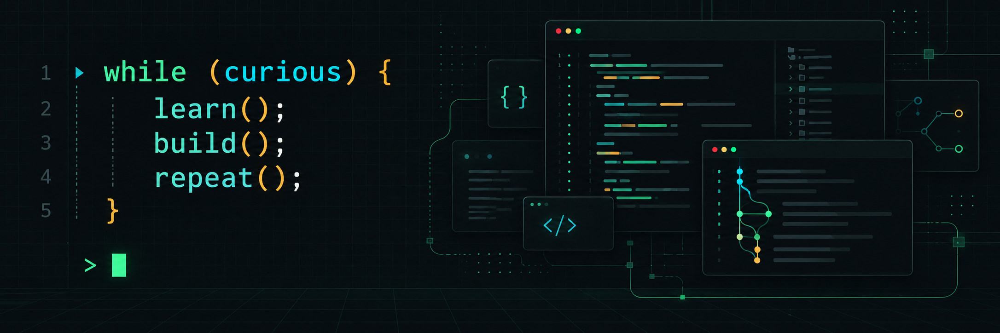

# Alby Raju

I'm a software engineer interested in backend systems, software architecture, and developer tools. I enjoy working through complex problems and finding designs that remain understandable as requirements change.

## Engineering interests

- **System design:** boundaries, integration patterns, and the tradeoffs behind reliable systems.
- **Developer experience:** tools and automation that shorten feedback loops and remove unnecessary work.
- **Diagnostics:** making system behavior easier to investigate and failures easier to explain.

## Approach

I start with the constraints, question assumptions, and prefer the simplest design that meets the need. I pay attention to failure modes, maintainability, and the cost of operating and changing software—not just the initial implementation.

This GitHub is a space for personal projects and technical exploration.
